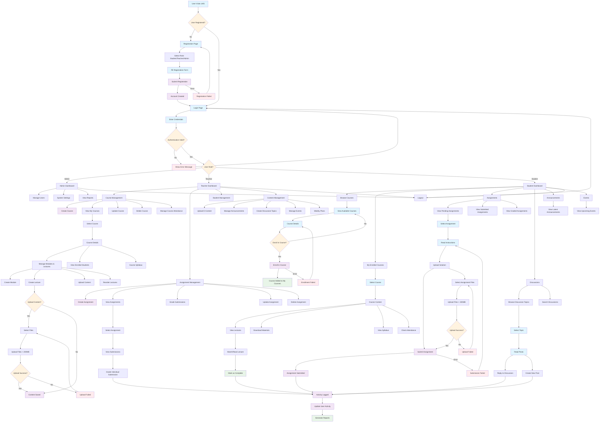

# LMS User Flow Diagram

## User Flow Summary

This diagram represents the comprehensive user flows for the Learning Management System with three main user types:

### 1. **Admin Users**
- System administration
- User management
- Reports and analytics

### 2. **Teacher Users**
- Course creation and management
- Module and lecture organization
- Assignment creation and grading
- Student progress tracking
- Content upload and management
- Discussion forum moderation

### 3. **Student Users**
- Course browsing and enrollment
- Lecture viewing and learning
- Assignment submission
- Discussion participation
- Progress tracking

### Key Features Covered:
- **Authentication & Authorization**: Role-based access control
- **Course Management**: Full CRUD operations for courses
- **Content Delivery**: Lectures, modules, e-content
- **Assignment System**: Creation, submission, and grading workflow
- **Discussion Forums**: Teacher-student and peer interactions
- **File Upload**: Support for large files (up to 200MB)
- **Activity Tracking**: User engagement monitoring
- **Error Handling**: Graceful failure recovery

The flow includes proper error handling, file upload limitations, and role-based access controls as implemented in the backend system.